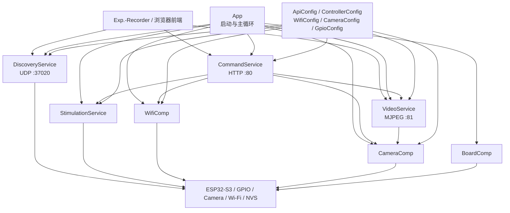
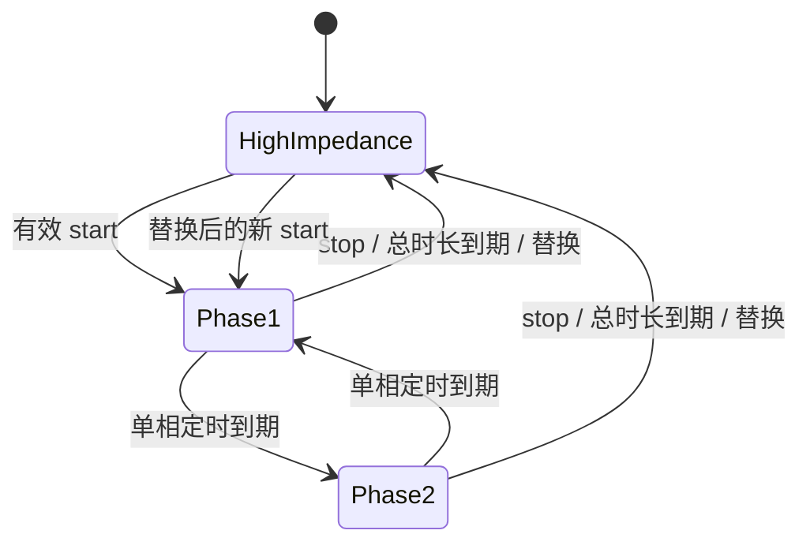
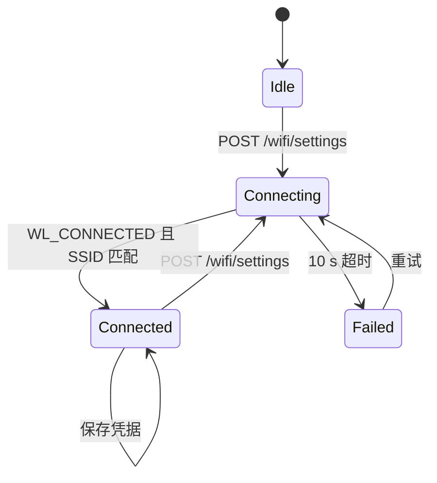
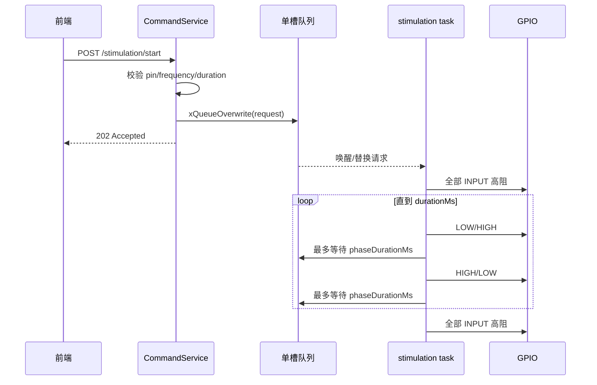

# InsectControllerDemo 嵌入式软件设计文档

| 项目 | 内容 |
| --- | --- |
| 文档类型 | 嵌入式软件设计文档（SDD） |
| 适用项目 | InsectControllerDemo |
| 目标硬件 | Seeed Studio XIAO ESP32S3 Sense |
| 软件框架 | Arduino ESP32 + FreeRTOS + ESP32 Camera |
| 文档基线 | 2026-11-02 工作区源码 |
| 文档状态 | 初版，与当前实现对齐 |

## 1. 文档概述

### 1.1 背景

InsectControllerDemo 是一套运行在 XIAO ESP32S3 Sense 上的局域网刺激与视频采集固件。板子通过两个可配置 GPIO 输出差分双相方波，并通过摄像头提供 MJPEG 实时视频和高分辨率拍照。前端 Exp.-Recorder 负责行为、通道和实验参数的业务管理，板端仅执行通用刺激参数和摄像头命令。

### 1.2 目的

本文档用于：

- 描述当前固件的软件架构、模块职责和依赖关系。
- 明确 GPIO、摄像头、Wi-Fi、HTTP、UDP 和 MJPEG 接口。
- 规定刺激时序、任务调度、数据管理和异常恢复逻辑。
- 为代码维护、测试验证、固件烧录和后续审查提供基线。

### 1.3 范围

本文档覆盖当前仓库内的板端固件，不包括：

- Exp.-Recorder 前端和后端的内部实现。
- 电极、限流、隔离、放大或 H 桥等外部电路设计。
- 生物实验参数的医学/伦理有效性评估。
- 云端、互联网远程控制或 OTA 升级。

### 1.4 术语与缩略语

| 术语 | 含义 |
| --- | --- |
| AP / SoftAP | 板子自建的 Wi-Fi 热点 |
| STA | 板子作为客户端连接外部 Wi-Fi |
| AP+STA | 热点和外部 Wi-Fi 客户端同时工作 |
| GPIO | 通用数字输入/输出 |
| 高阻 | GPIO 设为 `INPUT`，停止主动驱动电平 |
| 差分双相 | 两个输出脚以 LOW/HIGH 和 HIGH/LOW 交替输出 |
| MJPEG | 通过 multipart HTTP 连续传输 JPEG 帧 |
| PSRAM | ESP32-S3 外扩展伪静态 RAM |
| SCCB | 摄像头传感器控制总线，与 I²C 类似 |
| DVP | 摄像头并行数字视频接口 |
| NVS | ESP32 非易失键值存储，Arduino 中由 `Preferences` 封装 |

## 2. 系统概述

### 2.1 系统目标

系统提供一个与行为名称无关的嵌入式执行端：

1. 接收 `pin1`、`pin2`、`frequencyHz` 和 `durationMs`。
2. 在指定引脚之间生成差分双相方波。
3. 提供摄像头参数管理、MJPEG 视频和最大分辨率拍照。
4. 同时支持外部 Wi-Fi 和自建热点下的完整功能。
5. 通过 UDP 帮助前端在局域网中发现板子。

### 2.2 硬件平台

| 项目 | 配置 |
| --- | --- |
| MCU | ESP32-S3，双核 Xtensa LX7，最高 240 MHz |
| 开发板 | Seeed Studio XIAO ESP32S3 Sense |
| PSRAM | 8 MB（烧录配置 `PSRAM=opi`） |
| 无线 | 2.4 GHz Wi-Fi，支持 STA/SoftAP/AP+STA |
| 摄像头 | 运行时探测传感器型号，通过 DVP + SCCB 连接 |
| 刺激输出 | XIAO D0–D10 中任选两个数字 GPIO |
| 调试 | USB Serial/JTAG，115200 baud |

### 2.3 运行环境

- Arduino ESP32 Core。
- FreeRTOS（由 ESP32 Arduino 运行时提供）。
- `esp_camera`、`esp_http_server`、`WiFi`、`WebServer`、`WiFiUDP` 和 `Preferences`。
- 编译目标：`esp32:esp32:XIAO_ESP32S3:PSRAM=opi`。

### 2.4 运行模式

| 模式 | 进入条件 | 可用功能 |
| --- | --- | --- |
| STA | 已保存 Wi-Fi 或固件预设 Wi-Fi 连接成功 | 全部 HTTP API、MJPEG、UDP 发现、刺激、摄像头 |
| SoftAP | 启动时无法连接任一外部 Wi-Fi | 与 STA 相同的完整功能，默认 IP `192.168.4.1` |
| AP+STA | 通过 API 修改 Wi-Fi 且正在连接/已连接 | 转网期间保留热点管理通道；成功 5 s 后关闭热点 |

## 3. 软件需求

### 3.1 功能需求

| 编号 | 需求 |
| --- | --- |
| FR-01 | 上电后立即将 D0–D10 刺激引脚设为高阻。 |
| FR-02 | 验证两个引脚编号合法且不相同。 |
| FR-03 | 按指定频率和时长生成差分双相方波。 |
| FR-04 | 刺激超时、显式 stop 或新刺激替换时恢复安全状态。 |
| FR-05 | 支持摄像头参数读取与修改，并在失败时回滚。 |
| FR-06 | 提供单连接生产者的 MJPEG 实时视频。 |
| FR-07 | 支持最大分辨率 JPEG 拍照，拍照后恢复视频配置。 |
| FR-08 | 优先连接已保存 Wi-Fi，失败后尝试预设 Wi-Fi，再失败则创建 SoftAP。 |
| FR-09 | 通过 API 异步修改外部 Wi-Fi，不阻塞已在运行的刺激任务。 |
| FR-10 | 通过 API 修改并持久化 SoftAP 信道。 |
| FR-11 | 通过 UDP 广播请求返回板子 MAC、型号和端口。 |
| FR-12 | HTTP API 允许跨域访问，供局域网前端直接调用。 |

### 3.2 性能需求

- 刺激频率请求范围：1–500 Hz。
- 刺激时长请求范围：1–`UINT32_MAX` ms。
- 刺激时序精度：以 1 ms 为基本量化单位，不是微秒级硬件定时。
- 默认视频：有 PSRAM 时 VGA 640×480 @ 30 FPS 目标值；实际帧率受传感器、JPEG 大小和网络带宽影响。
- Wi-Fi 动态连接超时：10 s。
- SoftAP 在外部 Wi-Fi 连接成功后延迟 5 s 关闭。

### 3.3 可靠性与安全性需求

- 输出保护优先：任何刺激开始、替换或停止均先进入全引脚高阻。
- 新命令使用单槽覆盖队列，确保最新命令优先。
- 摄像头参数应在新鲜 JPEG 帧验证通过后才视为生效。
- Wi-Fi 凭据仅在实际连接成功后保存。
- API 必须拒绝越界、缺失或重复的关键参数。

## 4. 软件总体架构

### 4.1 分层架构



### 4.2 模块划分

| 模块 | 职责 | 主要依赖 |
| --- | --- | --- |
| `App` | 安全顺序启动、Arduino 主循环调度 | 全部组件和服务 |
| `BoardComp` | 上电时将刺激 GPIO 置为高阻 | `GpioConfig` |
| `WifiComp` | STA/SoftAP、转网状态机、扫描、NVS 持久化 | `WiFi`、`Preferences`、`WifiConfig` |
| `CameraComp` | 传感器探测、初始化、帧缓冲、参数回滚、拍照 | `esp_camera`、`CameraConfig` |
| `StimulationService` | 参数验证、GPIO 映射、双相方波、定时停止 | FreeRTOS Queue/Task、`GpioConfig` |
| `CommandService` | HTTP 路由、参数解析、JSON 响应、CORS | `WebServer`、业务服务 |
| `VideoService` | MJPEG 服务、单流生产者、节拍控制、统计 | `esp_http_server`、FreeRTOS、`CameraComp` |
| `DiscoveryService` | UDP 发现请求与板卡信息响应 | `WiFiUDP`、`esp_mac` |
| `config/*` | 引脚、路由、端口、参数范围和硬件配置 | 无业务依赖 |

### 4.3 初始化顺序

1. 启动 USB 串口，115200 baud。
2. `BoardComp::enable()` 将 D0–D10 置为 `INPUT`。
3. `WifiComp::enable()` 尝试已保存 Wi-Fi、预设 Wi-Fi 或 SoftAP。
4. `StimulationService::enable()` 再次确认刺激脚高阻。
5. 启动控制 HTTP 服务。
6. 探测并初始化摄像头。
7. 启动 MJPEG 视频服务。
8. 启动 UDP 发现服务。

## 5. 软件详细设计

### 5.1 刺激服务

#### 5.1.1 公开接口

```cpp
bool startStimulation(
    uint8_t pin1,
    uint8_t pin2,
    float frequencyHz,
    uint32_t durationMs
);

bool stopStimulation();
```

`pin1` 和 `pin2` 是 XIAO 板级 D 编号，不是 ESP32-S3 原始 GPIO 号。

#### 5.1.2 参数校验

- `pin1`/`pin2` 范围为 0–10。
- `pin1 != pin2`。
- `frequencyHz` 必须为有限浮点数，范围 1–500 Hz。
- `durationMs >= 1`。

#### 5.1.3 波形算法

单相持续时间：

```text
phaseDurationMs = round(500 / frequencyHz)
phaseDurationMs 最小为 1 ms
```

电平序列：

| 相位 | pin1 | pin2 | 理想差分电压 pin1-pin2 |
| --- | --- | --- | --- |
| 第一相 | LOW | HIGH | 约 -3.3 V |
| 第二相 | HIGH | LOW | 约 +3.3 V |

实际频率由整数毫秒量化：

```text
actualFrequencyHz ≈ 500 / phaseDurationMs
```

例如请求 300 Hz 时，`round(500/300)=2 ms`，实际约为 250 Hz。

#### 5.1.4 命令替换

- FreeRTOS 队列长度为 1。
- `xQueueOverwrite()` 保留最新请求，中间请求可被覆盖。
- 执行任务在单相等待期间阻塞于 `xQueueReceive()`，新命令或 stop 可提前唤醒。
- 替换时先将所有刺激脚设为高阻，再配置新引脚对。



### 5.2 Wi-Fi 组件

#### 5.2.1 启动策略

1. 从 NVS 读取已保存 SSID/密码，最多等待 10 s。
2. 若失败且预设 SSID 不同，尝试固件中的预设网络，最多等待 10 s。
3. 仍失败则创建 SoftAP。

启动阶段的 Wi-Fi 连接为同步等待，因此最坏可延迟约 20 s 后才进入主循环。

#### 5.2.2 动态转网状态机



- 动态连接在 `WifiComp::update()` 中非阻塞轮询。
- 转网前确保 SoftAP 存在，使配网失败后仍有管理通道。
- 连接成功后保存凭据，5 s 后关闭 SoftAP 并转为纯 STA。
- 连接失败时清除待用密码，SoftAP 继续运行。

#### 5.2.3 SoftAP 信道

- 仅支持 2.4 GHz，配置信道范围为 1–13，默认为 6。
- 信道保存至 NVS。
- SoftAP 运行时修改信道会在 API 响应后异步重启热点。
- AP+STA 模式使用同一射频，外部路由器信道优先。`actualChannel` 表示实际信道。

### 5.3 摄像头组件

#### 5.3.1 初始化与内存策略

1. 检测 PSRAM。
2. 以 VGA 探测传感器 PID、型号和最大分辨率。
3. 有 PSRAM 时按传感器最大分辨率分配 2 个帧缓冲，使用 `CAMERA_GRAB_LATEST`。
4. 无 PSRAM 时降级为 QVGA、1 个 DRAM 帧缓冲和 `CAMERA_GRAB_WHEN_EMPTY`。
5. 实时视频默认设为 VGA/30 FPS（无 PSRAM 时 QVGA）。

JPEG 质量值有 PSRAM 时为 18，无 PSRAM 时为 16；该数值越小质量越高、帧数据越大。

#### 5.3.2 参数修改与回滚

- 参数整组应用：分辨率、FPS、亮度、对比度、锐度、水平镜像和垂直翻转。
- 变更后丢弃两个可能的旧帧，验证第三个新帧的尺寸、JPEG SOI/EOI 和格式。
- 验证失败时重建上一组配置。
- 若回滚仍失败，尝试安全默认值：VGA/QVGA、15 FPS、图像控件归零、`vflip=true`。

#### 5.3.3 静态照片

1. 暂停 MJPEG 取帧，并等待当前帧使用者退出。
2. 切换至已分配缓冲支持的最大分辨率。
3. 获取一帧并复制到 PSRAM（失败时尝试 DRAM）。
4. 恢复拍照前配置并验证。
5. 恢复 MJPEG；如原流无法安全暂停，则完整重启视频服务。

### 5.4 MJPEG 视频服务

- 端口 81，路径 `/stream`。
- 响应格式：`multipart/x-mixed-replace;boundary=frame`。
- 每帧包含 JPEG `Content-Type` 和 `Content-Length`。
- 为连接禁用 Nagle（`TCP_NODELAY`）。
- 使用绝对时间点调度帧间隔，避免采集/发送时间累积成节拍漂移。
- 新的流连接会关闭旧 socket，只保留一个有效帧生产者。
- 公开统计包括流 ID、已发送帧数、JPEG 字节数、采集时间和发送时间。
- socket 发送超时 2 s，接收超时 1 s，最多 4 个打开 socket。

### 5.5 HTTP 控制服务

- 使用 Arduino `WebServer`，端口 80。
- 路由、端口和 UDP 协议字符串统一定义在 `ApiConfig.h`。
- 启用宽松 CORS，以支持局域网浏览器跨源访问。
- 刺激、Wi-Fi 凭据和 SoftAP 信道使用 JSON 请求体。
- 摄像头设置使用 URL/form 参数。
- JSON 由轻量自定义解析器处理，未引入通用 JSON 库。

### 5.6 UDP 发现服务

- 端口：37020/UDP。
- 对固定字符串做精确匹配，其他数据报直接忽略。
- 响应发送回请求方的 IP 和端口。
- 设备身份使用 STA MAC，不依赖 DHCP IP。

## 6. 硬件接口设计

### 6.1 刺激 GPIO

| API D 编号 | XIAO 标识 | ESP32-S3 GPIO | 其他板级功能 |
| ---: | --- | ---: | --- |
| 0 | D0 | GPIO1 | ADC/Touch |
| 1 | D1 | GPIO2 | ADC/Touch |
| 2 | D2 | GPIO3 | ADC/Touch |
| 3 | D3 | GPIO4 | ADC/Touch |
| 4 | D4 | GPIO5 | SDA/ADC/Touch |
| 5 | D5 | GPIO6 | SCL/ADC/Touch |
| 6 | D6 | GPIO43 | UART TX |
| 7 | D7 | GPIO44 | UART RX |
| 8 | D8 | GPIO7 | SPI SCK/ADC/Touch |
| 9 | D9 | GPIO8 | SPI MISO/ADC/Touch |
| 10 | D10 | GPIO9 | SPI MOSI/ADC/Touch |

当某引脚用于刺激时，不得同时用于 UART、I²C、SPI、ADC 或其他外设功能。

### 6.2 摄像头接口

| 信号 | GPIO | 说明 |
| --- | ---: | --- |
| XCLK | 10 | 20 MHz，由 LEDC Channel 0 / Timer 0 生成 |
| SCCB SDA | 40 | 传感器配置数据 |
| SCCB SCL | 39 | 传感器配置时钟 |
| D0–D7 | 15, 17, 18, 16, 14, 12, 11, 48 | 8-bit DVP 图像数据 |
| VSYNC | 38 | 帧同步 |
| HREF | 47 | 行有效 |
| PCLK | 13 | 像素时钟 |
| PWDN | -1 | 未使用 |
| RESET | -1 | 未使用 |
| USER LED | 21 | 初始化为低电平 |

### 6.3 UART、I²C、SPI、PWM 与 ADC

| 接口 | 当前用途 |
| --- | --- |
| UART/USB Serial | 115200 baud 日志；D6/D7 未被固件配置为外部 UART |
| I²C/SCCB | GPIO39/40 用于摄像头 SCCB；外露 D4/D5 未被当前业务使用 |
| SPI | 固件未使用外部 SPI；D8/D9/D10 可被刺激功能占用 |
| PWM/LEDC | 仅摄像头 XCLK 使用；刺激使用普通 `digitalWrite()`，不是 PWM |
| ADC | 当前不采集模拟量；可用刺激脚的 ADC 复用功能不使用 |

### 6.4 电气边界

固件仅输出 ESP32-S3 3.3 V 数字电平，未实现 DAC、恒流、限流、隔离、过压保护或电荷平衡闭环。外部硬件必须保证负载不超出 GPIO 能力，并满足实验安全要求。

## 7. 通信协议设计

### 7.1 网络端口

| 端口 | 协议 | 用途 |
| ---: | --- | --- |
| 80 | HTTP/TCP | 配置、刺激、Wi-Fi、摄像头和统计 API |
| 81 | HTTP/TCP | MJPEG `/stream` |
| 37020 | UDP | Exp.-Recorder 局域网发现 |

### 7.2 HTTP API 汇总

| 方法 | 路径 | 请求 | 成功响应 | 用途 |
| --- | --- | --- | --- | --- |
| GET | `/config` | 无 | 200 JSON | 读取型号、端口和刺激限制 |
| POST | `/stimulation/start` | JSON | 202 JSON | 异步启动/替换刺激 |
| POST | `/stimulation/stop` | 无 | 202 JSON | 异步停止刺激 |
| GET | `/camera/settings` | 无 | 200 JSON | 读取摄像头设置、范围和 PSRAM 状态 |
| POST | `/camera/settings` | URL/form 参数 | 200 JSON | 修改摄像头设置 |
| GET | `/camera/capture` | 无 | 200 JPEG | 最大分辨率拍照 |
| GET | `/stream/stats` | 无 | 200 JSON | 读取 MJPEG 统计 |
| GET | `/wifi/networks` | 无 | 200 JSON | 同步扫描附近网络 |
| GET | `/wifi/settings` | 无 | 200 JSON | 读取 AP/STA 连接状态 |
| POST | `/wifi/settings` | JSON | 202 JSON | 异步连接新 Wi-Fi |
| GET | `/wifi/access-point` | 无 | 200 JSON | 读取 SoftAP 频段和信道 |
| POST | `/wifi/access-point` | JSON | 202 JSON | 修改并持久化 SoftAP 信道 |
| GET | `:81/stream` | 无 | 200 multipart | MJPEG 实时视频 |

### 7.3 刺激协议

```http
POST /stimulation/start
Content-Type: application/json

{
  "pin1": 1,
  "pin2": 3,
  "frequencyHz": 50,
  "durationMs": 300
}
```

```json
{
  "ok": true,
  "pin1": 1,
  "pin2": 3,
  "frequencyHz": 50.000,
  "durationMs": 300
}
```

### 7.4 Wi-Fi 协议

`GET /wifi/settings` 返回：

- `connectionState`：`idle` / `connecting` / `connected` / `failed`。
- `accessPoint.active/ssid/ip`。
- `station.connected/ssid/ip`。
- `error`：无错误时为 `null`。

`POST /wifi/settings` 请求：

```json
{
  "ssid": "Lab Wi-Fi",
  "password": "example-password"
}
```

`POST /wifi/access-point` 请求：

```json
{
  "channel": 11
}
```

SoftAP 默认配置：

| 参数 | 值 |
| --- | --- |
| SSID | `XIAOESP32S3` |
| 密码 | `xiaoesp32s3` |
| IP | 通常为 `192.168.4.1` |
| 频段 | 2.4 GHz |
| 默认信道 | 6 |

### 7.5 摄像头参数

| 参数 | 取值 |
| --- | --- |
| `resolution` | `2048x1536`、`1920x1080`、`1280x720`、`1024x768`、`640x480`、`320x240`；以传感器/缓冲支持为准 |
| `fps` | 1–120，同时受分辨率上限约束 |
| `brightness` | -2–2 |
| `contrast` | -2–2 |
| `sharpness` | -2–2 |
| `hmirror` | `true` / `false` / `1` / `0` |
| `vflip` | `true` / `false` / `1` / `0` |

### 7.6 HTTP 状态码

| 状态码 | 含义 |
| ---: | --- |
| 200 | 同步读取/修改成功 |
| 202 | 异步请求已接受 |
| 204 | CORS `OPTIONS` 成功 |
| 400 | 缺少参数、格式错误或超出范围 |
| 404 | 路由不存在 |
| 409 | Wi-Fi 配置正忙 |
| 500 | 摄像头应用/恢复失败或扫描失败 |
| 503 | 摄像头、视频或刺激执行器不可用 |

### 7.7 UDP 发现协议

请求负载：

```text
EXP_RECORDER_DISCOVER_V1
```

响应：

```json
{
  "protocol": "EXP_RECORDER_BOARD_V1",
  "mac": "E0:72:A1:FB:63:0C",
  "model": "XIAO ESP32S3 Sense",
  "control_port": 80,
  "video_port": 81
}
```

### 7.8 BLE

当前固件未启用 BLE，所有业务通信均通过 Wi-Fi、HTTP/TCP 和 UDP 完成。

## 8. 任务与时序设计

### 8.1 任务清单

| 任务/执行上下文 | 创建方式 | 优先级 | 栈 | 核 | 职责 |
| --- | --- | ---: | ---: | --- | --- |
| Arduino `loopTask` | 框架创建 | 由框架决定 | 由框架决定 | 由框架决定 | Wi-Fi 状态机、控制 HTTP、UDP 发现 |
| `stimulation` | 首次 start/stop 时惰性创建 | 2 | 4096 bytes | 未绑定 | 刺激波形和定时停止 |
| `mjpeg-stream` | 每次有效流连接创建 | 1 | 8192 bytes | Core 1 | 取帧、multipart 封装和 TCP 发送 |
| HTTP server task | `esp_http_server` 内部创建 | 框架默认 | 8192 bytes | 框架决定 | 端口 81 连接和路由 |
| Wi-Fi/系统任务 | ESP-IDF 内部创建 | 框架决定 | 框架决定 | 框架决定 | 无线协议栈、TCP/IP |

### 8.2 主循环

```text
loop:
  WifiComp::update()
  CommandService::update()
  DiscoveryService::update()
  delay(1)
```

`delay(1)` 用于让出 CPU，避免主循环忙等待。

### 8.3 刺激时序



### 8.4 摄像头互斥时序

- MJPEG 任务在取帧前通过临界区增加 `streamCameraUsers`。
- 修改设置/拍照时设置 `pauseRequested`，最多等待约 2.5 s 直到使用者归零。
- 如无法安全暂停，则关闭流 socket 并重启视频服务。
- 自旋锁 `portMUX_TYPE` 仅保护计数器和状态，不在临界区内执行阻塞 I/O。

## 9. 数据设计

### 9.1 刺激请求

```cpp
struct StimulationRequest {
  bool stop;
  uint8_t pin1;             // 队列内已转换为真实 GPIO
  uint8_t pin2;
  uint16_t phaseDurationMs;
  uint32_t durationMs;
};
```

该结构仅存在于刺激服务内部，队列容量为 1。

### 9.2 摄像头设置

```cpp
struct Settings {
  framesize_t frameSize;
  uint8_t fps;
  int8_t brightness;
  int8_t contrast;
  int8_t sharpness;
  bool hmirror;
  bool vflip;
};
```

### 9.3 视频统计

```cpp
struct StreamStats {
  bool active;
  uint32_t streamId;
  uint32_t framesSent;
  uint64_t jpegBytesSent;
  uint64_t captureTimeMs;
  uint64_t sendTimeMs;
};
```

统计数据由临界区保护，HTTP 端获取一致快照。

### 9.4 NVS 数据

`Preferences` 命名空间：`wifi-config`。

| Key | 类型 | 内容 | 写入时机 |
| --- | --- | --- | --- |
| `ssid` | String | 已成功连接的外部 Wi-Fi SSID | 动态连接成功后 |
| `password` | String | Wi-Fi 密码 | 动态连接成功后 |
| `ap-channel` | `uint8_t` | SoftAP 配置信道 | 热点信道修改时 |

### 9.5 缓冲与动态内存

- HTTP JSON 响应主要使用 Arduino `String`。
- MJPEG 直接传输摄像头帧缓冲，发送后立即归还。
- 静态照片复制到独立堆缓冲，优先 PSRAM，HTTP 发送后释放。
- MJPEG 任务上下文使用 `malloc/free`。

## 10. 安全与异常处理

### 10.1 刺激安全状态

- 上电初始化先于网络和摄像头。
- 除当前两个激活脚外，D0–D10 全部为高阻。
- 超时、stop、新命令替换和执行错误都会返回高阻。
- 系统重启后依靠初始化顺序重建安全状态。

### 10.2 参数和协议异常

- 数字转换检查结束指针、溢出、NaN/Infinity 和范围。
- 自定义 JSON 解析器拒绝关键字段重复。
- 未匹配路由返回 404 JSON。
- Wi-Fi 或 SoftAP 配置重入返回 409。

### 10.3 摄像头异常

- 初始化、取帧、参数应用和新帧验证均检查返回值。
- 参数修改失败时先回滚上一设置，再尝试安全默认配置。
- 静态照片必须恢复拍照前配置；恢复失败则丢弃照片并返回错误。
- 流 socket 阻塞受 2 s 发送超时约束。

### 10.4 Wi-Fi 异常

- 启动连接失败时退化为 SoftAP。
- API 转网失败时保留 SoftAP、不覆盖已保存的有效凭据。
- 修改 SoftAP 信道会中断当前 AP 连接，前端应显示重连提示。
- AP+STA 模式下实际信道可由 STA 网络覆盖。

### 10.5 看门狗与自恢复现状

当前应用未显式配置应用层看门狗、健康心跳、brownout 恢复策略或崩溃计数器；仅依赖 Arduino/ESP-IDF 默认系统机制。对长时间无人实验，建议后续增加：

- Task Watchdog 注册与喂狗点。
- 重启原因、崩溃次数和上次异常的 NVS 记录。
- Wi-Fi 运行中掉线后的自动重连/SoftAP 回退。

### 10.6 网络安全现状

当前 HTTP/MJPEG/UDP 接口无 TLS、无用户鉴权、无命令签名，CORS 允许任意来源。Wi-Fi 密码以明文形式存在 NVS，且固件包含预设 Wi-Fi 和 SoftAP 密码。因此本固件仅应用于受控局域网，不应直接暴露到互联网。

## 11. 性能与资源设计

### 11.1 当前编译资源

以 `esp32:esp32:XIAO_ESP32S3:PSRAM=opi` 编译的当前基线：

| 资源 | 使用 | 上限 | 占比 |
| --- | ---: | ---: | ---: |
| Flash | 1,033,798 bytes | 3,342,336 bytes | 30% |
| 全局动态内存 | 58,272 bytes | 327,680 bytes | 17% |
| 余下内部动态内存 | 269,408 bytes | — | — |
| PSRAM | 运行时检测，目标板为 8 MB | — | 用于摄像头帧和静态照片 |

上述 RAM 数据不包括运行时任务栈、堆、TCP 缓冲和 PSRAM 分配。

### 11.2 CPU 与实时性

- 刺激任务优先级 2，高于 MJPEG 工作任务的优先级 1。
- 刺激输出使用软件任务、`millis()` 和 RTOS tick，存在调度抖动，不属于硬实时输出。
- 两个 GPIO 由两次连续 `digitalWrite()` 切换，不是原子同步翻转，换相瞬间可存在极短的共高或共低过渡。
- Wi-Fi 扫描由控制 HTTP 上下文同步执行，扫描期间其他端口 80 请求会延迟，但独立刺激任务仍可持续。
- 摄像头设置/拍照可暂停视频取帧，不应与高实时控制要求混同。

### 11.3 网络性能

- MJPEG 每帧两次主要 TCP 写入：分隔符/头和 JPEG 负载。
- 只允许一个有效视频生产者，避免多客户端竞争摄像头帧缓冲。
- Wi-Fi 省电被关闭，以降低视频和命令延迟，代价是较高功耗。

## 12. 软件测试与验证

### 12.1 当前验证状态

- 当前仓库未包含自动化单元测试框架或硬件在环测试程序。
- 当前基线已通过 Arduino CLI 完整编译。
- 固件已在 ESP32-S3 上通过 esptool 写入和 Flash Hash 校验。
- 编译/烧录成功不等价于所有功能和电气指标已通过系统测试。

### 12.2 单元测试建议

| 编号 | 对象 | 用例 | 期望结果 |
| --- | --- | --- | --- |
| UT-01 | GPIO 映射 | D0–D10 及越界值 | 合法编号映射正确，越界返回 -1 |
| UT-02 | 刺激校验 | 相同 pin、NaN、0/501 Hz、0 ms | 全部拒绝 |
| UT-03 | 频率换算 | 1、50、300、500 Hz | 单相时长分别约 500、10、2、1 ms |
| UT-04 | JSON 数字解析 | 正常、缺字段、重复字段、溢出 | 错误输入拒绝 |
| UT-05 | JSON 字符串解析 | SSID 转义、空密码、超长字符串 | 正确解码和范围检查 |
| UT-06 | Wi-Fi 状态机 | 成功、超时、忙状态重入 | 状态与错误码符合设计 |

### 12.3 集成测试

| 编号 | 场景 | 验证点 |
| --- | --- | --- |
| IT-01 | 开机且无外部 Wi-Fi | 创建 SoftAP，IP 可访问，所有 API 可用 |
| IT-02 | SoftAP 下运行刺激和视频 | 两者并行，刺激时序在许可抖动内 |
| IT-03 | 刺激期间修改 Wi-Fi | 刺激任务不中断，Wi-Fi 状态可轮询 |
| IT-04 | 新刺激覆盖旧刺激 | 先高阻，再从第一相启动新引脚对 |
| IT-05 | stop 命令 | stop 到达后所有 D0–D10 恢复高阻 |
| IT-06 | 视频中修改分辨率 | 流暂停/恢复，无旧分辨率残留帧 |
| IT-07 | 视频中拍照 | 照片为最大分辨率，流恢复原配置 |
| IT-08 | 多浏览器重连 MJPEG | 旧 socket 关闭，仅最新流生产帧 |
| IT-09 | 修改 SoftAP 信道 | API 先返回 202，热点重启，配置重启后保留 |
| IT-10 | AP+STA 信道不同 | `actualChannel` 跟随 STA，`stationOverridesChannel=true` |
| IT-11 | UDP 发现 | 正确请求收到 JSON，错误请求无响应 |

### 12.4 系统与长稳测试

- 连续 8/24/72 h MJPEG 流稳定性：堆、PSRAM、帧数、平均帧大小、发送时间。
- 连续重复拍照 1,000 次，检查内存泄漏和视频恢复。
- 连续替换刺激命令，用逻辑分析仪测量相位、频率、停止延迟和过渡脉冲。
- 断路由器、输入错密码、DHCP 失败、低 RSSI 和频道切换测试。
- 多次掉电/上电，验证 NVS 凭据、SoftAP 信道和 GPIO 安全状态。
- 在最大 JPEG、高 FPS、Wi-Fi 扫描和刺激并发情况下做资源压力测试。

### 12.5 电气验证

- 空载测量每个可选 GPIO 的 VOH/VOL。
- 差分测量使用差分探头，或两通道对板子 GND 后做 CH1-CH2；不得将接地夹接到任一激活 GPIO。
- 在代表性电极负载下测量电压下降、电流、波形对称性和温升。
- 核对外部限流/隔离电路，不应仅依赖 MCU GPIO 保护。

## 13. 构建与部署

### 13.1 工具链

- `arduino-cli`。
- Arduino ESP32 Core（当前开发环境使用 3.3.11）。
- esptool 5.3.1（由 Arduino ESP32 Core 调用）。
- macOS/Linux shell；仓库提供 `flash.sh`。

### 13.2 编译

```bash
arduino-cli compile \
  --fqbn esp32:esp32:XIAO_ESP32S3:PSRAM=opi \
  --build-path /tmp/InsectControllerDemo-build \
  .
```

### 13.3 烧录

```bash
./flash.sh /dev/cu.usbmodem1101
```

或：

```bash
arduino-cli upload \
  --port /dev/cu.usbmodem1101 \
  --fqbn esp32:esp32:XIAO_ESP32S3:PSRAM=opi \
  --input-dir /tmp/InsectControllerDemo-build \
  .
```

烧录成功标准：

- bootloader、partition table、boot app 和 application 镜像写入成功。
- esptool 对每个分区执行 Hash 校验成功。
- RTS 硬件复位后串口可见正常启动日志。

### 13.4 版本与可复现性

建议每次发布记录：

- Git commit/tag。
- Arduino ESP32 Core 和 arduino-cli 版本。
- FQBN 及所有 board options。
- 编译产物 SHA-256。
- Flash/内存使用量。
- 目标板 MAC、硬件版本和摄像头 PID。
- 关键配置变更及协议兼容性说明。

## 14. 附录

### 14.1 源码目录

```text
InsectControllerDemo.ino        Arduino 入口
src/app/                       启动和主循环
src/components/                硬件组件封装
src/config/                    路由、端口、引脚和参数配置
src/services/                  刺激、HTTP、视频和发现服务
docs/EXP_RECORDER_API.md       前端集成 API 说明
flash.sh                       编译与烧录脚本
```

### 14.2 主要配置文件

| 文件 | 内容 |
| --- | --- |
| `ApiConfig.h` | HTTP/UDP 端口、全部 API 路径、发现协议 |
| `ControllerConfig.h` | 刺激范围、任务栈和优先级 |
| `GpioConfig.h` | D0–D10 可选刺激引脚 |
| `CameraConfig.h` | DVP/SCCB/LED/XCLK 引脚和帧缓冲策略 |
| `WifiConfig.h` | 连接超时、SoftAP 凭据、信道和预设 STA 凭据 |

### 14.3 已知边界与后续改进

| 项目 | 当前状态 | 建议 |
| --- | --- | --- |
| 刺激时序 | 毫秒级软件定时 | 高精度需求改用硬件 Timer/RMT/MCPWM |
| GPIO 换相 | 两次 `digitalWrite()` | 需无毛刺换相时使用寄存器同步写或外部驱动器 |
| 电气保护 | 固件无法提供限流/隔离 | 在硬件中增加受控驱动级和故障断路 |
| HTTP 安全 | 无 TLS/鉴权，宽松 CORS | 加入设备令牌、命令签名或网关代理 |
| Wi-Fi 扫描 | 同步阻塞端口 80 | 改为异步扫描状态机 |
| JSON | 轻量定制解析 | 扩展协议时考虑统一 JSON 库和 schema 验证 |
| 看门狗 | 无应用层显式设计 | 增加 Task WDT、健康状态和异常重启记录 |
| 掉线恢复 | 启动失败可回退 AP，运行中掉线无完整状态机 | 增加运行中重连和 AP 回退 |
| 测试自动化 | 尚无测试工程 | 增加主机单测试、硬件在环和长稳 CI |
| 协议版本 | 仅 UDP 发现包含版本标识 | 为 HTTP `/config` 增加 firmware/API version |

### 14.4 参考文件

- `README.md`
- `docs/EXP_RECORDER_API.md`
- Seeed Studio XIAO ESP32S3 Sense 引脚图与原理图。
- Espressif ESP32-S3 Datasheet。
- ESP-IDF Wi-Fi、GPIO、HTTP Server 和 FreeRTOS API 文档。
- ESP32 Camera Driver 文档。

